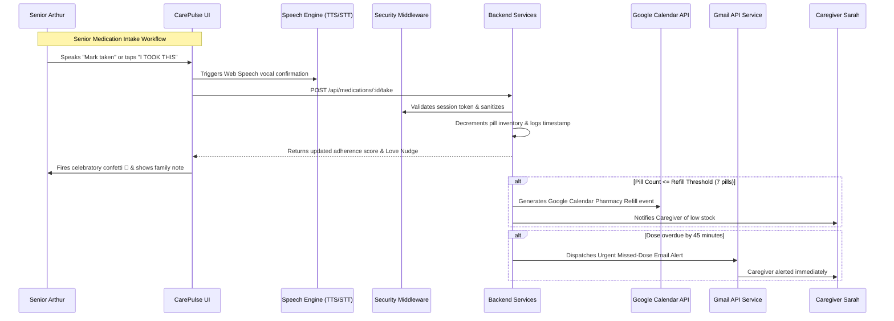

# 🏛️ CarePulse Architectural Blueprint & System Design

## 1. System Overview

CarePulse is structured as an offline-first, client-synchronized healthcare platform. It provides specialized interfaces for four key stakeholders:
1. **Elderly Senior** (Senior-accessible, voice-driven, jumbo tactile touch targets)
2. **Primary Caregiver** (Full schedule control, inventory, drug interactions, vitals)
3. **Remote Family Member** (Peace-of-mind adherence streak, live activity feed, emotional Love Nudges)
4. **Attending Physician** (Diagnostic overview, clinical review, RFC-5545 `.ics` export)

---

## 2. Component Hierarchy

```
d:\hackathon\
├── index.html                   # HTML entry point with accessible font preloading
├── vite.config.js               # Vite 6 + Tailwind v4 + Proxy config
├── package.json                 # Modern dependencies & test scripts
├── .gitignore                   # Clean version control exclusions
├── .env.example                 # Environment configuration template
│
├── server/                      # Node.js & Express REST Backend
│   ├── app.js                   # Express app with OWASP security headers & routes
│   ├── index.js                 # API server entry (Port 3001)
│   ├── data/
│   │   └── initialData.js       # Seed medical data & default roles
│   ├── middleware/
│   │   └── securityMiddleware.js# Rate-limiting, security headers, RBAC
│   ├── services/
│   │   ├── adherenceService.js  # Compliance metrics & streak engine
│   │   ├── authService.js       # PBKDF2 hashing & HMAC session tokens
│   │   ├── calendarService.js   # Google Calendar intent & RFC-5545 ICS
│   │   ├── drugInteractionService.js # AI clinical pharmacology analyzer
│   │   └── emailReminderService.js   # Gmail HTML briefings & missed-dose alerts
│   └── utils/
│       └── sanitizer.js         # XSS recursive input sanitizer
│
├── src/                         # Frontend Application (React 19)
│   ├── App.jsx                  # Main state container & role coordinator
│   ├── main.jsx                 # React root renderer
│   ├── index.css                # Tailwind CSS v4 & Senior-accessible themes
│   ├── config/
│   │   └── branding.js          # Centralized brand customizer
│   ├── components/
│   │   ├── Navbar.jsx           # Accessible header, role switcher, zoom, SOS
│   │   ├── SeniorView.jsx       # 4-compartment virtual pillbox & voice
│   │   ├── CaretakerView.jsx    # Prescription CRUD, inventory, appointments
│   │   ├── FamilyView.jsx       # Adherence streak (🔥) & Love Nudges
│   │   ├── DoctorView.jsx       # Clinical chart & RFC-5545 export
│   │   ├── PinPadModal.jsx      # Tactile 4-digit numeric keypad
│   │   ├── PillVisual.jsx       # 2D/3D pill shape/color graphics
│   │   ├── EmergencyModal.jsx   # Paramedic Medical ID & Web Audio siren
│   │   ├── EmailPreviewModal.jsx# Gmail API HTML preview & test sender
│   │   ├── DrugInteractionModal.jsx # Clinical interaction modal
│   │   └── NudgePopupModal.jsx  # Family cheer popup with confetti
│   └── services/
│       ├── apiService.js        # Offline-first API client with local fallback
│       ├── audioService.js      # Web Audio API oscillators (chimes & sirens)
│       └── speechService.js     # Web Speech API (TTS & Speech-to-Text)
│
├── tests/                       # Automated Test Suite (100% Pass)
│   ├── adherence.test.js        # Compliance % & streak calculations
│   ├── auth.test.js             # PBKDF2 hashing, tokens, XSS sanitizer
│   ├── calendar.test.js         # Google Calendar URL & ICS generation
│   ├── drugInteraction.test.js  # Pharmacology conflict rules
│   ├── email.test.js            # HTML email template generation
│   └── security.test.js         # Security headers & rate-limiting lockout
│
└── docs/                        # Comprehensive Documentation
    ├── ARCHITECTURE.md          # System design & component structure
    ├── SECURITY.md              # Cryptographic algorithms & OWASP defense
    └── API.md                   # Complete REST API specification
```

---

## 3. Data Flow Architecture


